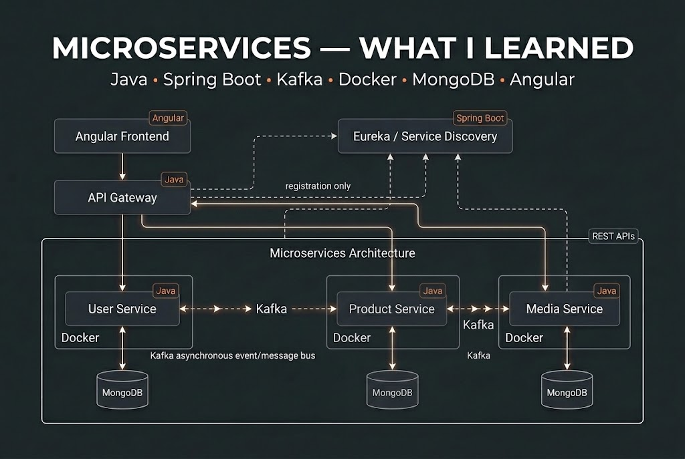

# Buy 01 — E-Commerce Microservices Platform

A full-stack e-commerce marketplace built with **Spring Boot microservices, Angular, MongoDB, Apache Kafka, and Docker Compose**. The platform allows users to register as clients or sellers, browse products, and manage product listings and images.

## Table of Contents

- [Overview](#overview)
- [Architecture](#architecture)
- [Features](#features)
- [Technology Stack](#technology-stack)
- [Prerequisites](#prerequisites)
- [Environment Configuration](#environment-configuration)
- [Getting Started](#getting-started)
- [CI/CD with Jenkins](#cicd-with-jenkins)
- [Accessing the Application](#accessing-the-application)
- [API Endpoints](#api-endpoints)
- [Kafka Event Flow](#kafka-event-flow)
- [Database and Storage](#database-and-storage)
- [Troubleshooting](#troubleshooting)
- [Project Structure](#project-structure)

## Overview

Buy 01 is a marketplace application designed around independently deployable backend services. Each service has a specific responsibility, while the API Gateway provides a single entry point for frontend requests.

The project demonstrates microservice architecture, REST API development, authentication and authorization, event-driven communication, file uploads, and containerized deployment.

## Architecture



The backend consists of the following components:

| Component | Responsibility |
|---|---|
| Angular Frontend | User interface, authentication forms, product listings, and seller dashboard |
| API Gateway | Entry point for client requests and routing to backend services |
| Eureka Server | Service registration and discovery |
| User Service | Registration, login, user profiles, and roles |
| Product Service | Product creation, retrieval, updating, and deletion |
| Media Service | Image management and Cloudinary integration |
| MongoDB | Persistence for users, products, and media metadata |
| Apache Kafka | Asynchronous communication between services |
| Cloudinary | External storage for uploaded images |

### Service Communication

- The frontend communicates with the backend through the API Gateway.
- The API Gateway routes requests to registered services.
- Backend services use Eureka for service discovery.
- MongoDB stores application data.
- Kafka transports asynchronous events between the Product Service and Media Service.
- Cloudinary stores image files, while the application stores their references and related metadata.

## Features

### Authentication and Authorization
- User registration and login.
- Client and seller roles.
- JWT-based authentication.
- Password hashing and protected endpoints.
- Role-based access to seller operations.

### Product Management
- Browse available products.
- Retrieve product details.
- Create, update, and delete products.
- Associate products with image URLs.
- Protect seller operations according to the application's authorization rules.

### Media Management
- Upload product images.
- Store images using Cloudinary.
- Keep image references in the application database.
- Use Kafka events to communicate product-deletion information for image cleanup.

### Infrastructure
- Independent Spring Boot services.
- Eureka service discovery.
- Centralized API routing.
- MongoDB persistence.
- Kafka event-driven communication.
- Docker Compose orchestration.

## Technology Stack

| Technology | Purpose |
|---|---|
| Java | Backend programming language |
| Spring Boot | Backend microservices |
| Spring Security | Authentication and authorization |
| Spring Cloud Gateway | API Gateway |
| Netflix Eureka | Service discovery |
| Spring Data MongoDB | Database integration |
| Apache Kafka | Asynchronous messaging |
| Angular | Frontend application |
| TypeScript | Frontend programming language |
| MongoDB | NoSQL database |
| Cloudinary | Image storage |
| Docker | Application containerization |
| Docker Compose | Multi-container orchestration |
| Maven | Java dependency management and builds |

## Prerequisites

Before running the project, install:

- **Git** — to clone the repository.
- **Docker Engine or Docker Desktop** — to run the containers.
- **Docker Compose v2** — available through the `docker compose` command.
- **Cloudinary account and credentials** — required if image operations use your Cloudinary account.
- A modern web browser.

Java, Maven, Node.js, and Angular CLI may also be required if you want to run or develop individual services outside Docker. When running the complete application through Docker Compose, you generally do not need to install those tools separately.

Check your installations:

```bash
git --version
docker --version
docker compose version
```

## Environment Configuration

The local `jenkins/.env` file supplies settings to Jenkins and the application. Create it from the template:

```bash
cp .env.example jenkins/.env
```

Open `jenkins/.env` in a text editor and set each value below. Keep the variable names as written; replace the value after `=`. Values marked required must be filled in before starting Jenkins. Since the environment file is inside `jenkins/`, pass `--env-file jenkins/.env` to Compose commands run from the repository root.

| Variable | What to enter |
|---|---|
| `JENKINS_ADMIN_ID` | Jenkins login name. `admin` is the default. |
| `JENKINS_ADMIN_PASSWORD` | A strong password for the Jenkins login. Required. |
| `JENKINS_PORT` | Port on your computer for Jenkins. Keep `8088` to open Jenkins at `http://localhost:8088`. |
| `GITHUB_REPOSITORY_URL` | HTTPS clone URL of the private repository Jenkins should poll. The template points to this project. |
| `GITHUB_BRANCH` | Branch Jenkins should poll. The template is set to `master`. |
| `GITHUB_USERNAME` | GitHub username associated with the access token. Required. |
| `GITHUB_TOKEN` | A fine-grained GitHub personal access token restricted to this repository, with read-only Contents access. Required. Create the token in GitHub settings and paste it here. |
| `DOCKER_GID` | Group ID for `/var/run/docker.sock`, so Jenkins can deploy the application. On Linux, get it with `stat -c '%g' /var/run/docker.sock`. |
| `JWT_SECRET` | Shared signing secret used by the application services. Replace the development example with a random value; on Linux or macOS, generate one with `openssl rand -hex 32`. |
| `SONAR_PORT` | Host port for the SonarQube dashboard. Defaults to `9000`. |
| `SONAR_DB_PASSWORD` | Password for SonarQube's private PostgreSQL database. The local example default works for this Compose-only setup; set a unique value if exposing or sharing the server. |
| `SONAR_TOKEN` | SonarQube analysis token used by Jenkins. Generate it in SonarQube after starting its containers, then save it here. Keep it secret. |

**Security notes:**
- Never commit `jenkins/.env` or real credentials to Git. The repository ignores `.env` files.
- Treat GitHub and SonarQube tokens as secrets. Do not paste them into chat or commit them in `.env.example`.
- The `JWT_SECRET` value in `.env.example` is for development only; replace it before deployment.

## Getting Started

### 1. Clone the repository

```bash
git clone <YOUR_REPOSITORY_URL>
cd 01-buy
```

Replace `<YOUR_REPOSITORY_URL>` with your Git repository URL.

### 2. Configure the environment

Create and complete `jenkins/.env` as described in [Environment Configuration](#environment-configuration).

### 3. Build the containers

```bash
docker compose --env-file jenkins/.env build --no-cache
```

This rebuilds the container images without using cached build layers.

### 4. Start the application

```bash
docker compose --env-file jenkins/.env up
```

To run the application in the background:

```bash
docker compose --env-file jenkins/.env up -d
```

Docker Compose starts the services defined in the Compose configuration, including the backend services, frontend, databases, and Kafka infrastructure.

On the first run, allow time for images to download, services to initialize, and databases to become available.

### 5. Check service status

```bash
docker compose --env-file jenkins/.env ps
```

Inspect the logs if a service fails to start:

```bash
docker compose --env-file jenkins/.env logs -f
```

To inspect one service:

```bash
docker compose --env-file jenkins/.env logs -f product-service
```

Replace `product-service` with the service name defined in your Compose file.

### 6. Rebuild after making code changes

To stop the running containers:

```bash
docker compose --env-file jenkins/.env down
```

To rebuild all images:

```bash
docker compose --env-file jenkins/.env build --no-cache
```

To start the application again:

```bash
docker compose --env-file jenkins/.env up
```

These commands are useful when you want to ensure that the latest code is included in the rebuilt images.

**Note:** `docker compose down` removes the Compose containers and networks but normally preserves named volumes. Avoid `docker compose down -v` unless you intentionally want to delete the persisted database and Kafka data.

## CI/CD with Jenkins

Jenkins runs separately from the application stack. Its plugins, admin account, and `buy-01` pipeline are created automatically from `jenkins/casc.yaml`; there is no Jenkins setup wizard or manual job creation. The dashboard is optional and is available at `http://localhost:8088` for build logs.

SonarQube and its PostgreSQL database run in the same CI Compose project as Jenkins, separately from the application stack. For the first setup, start SonarQube by itself:

```bash
docker compose --env-file jenkins/.env -f jenkins/compose.yml up -d sonarqube-db sonarqube
```

Open `http://localhost:9000`, sign in with `admin` / `admin`, and change the password. In **My Account > Security**, generate a token and add it to `SONAR_TOKEN` in `jenkins/.env`. SonarQube must be running before Jenkins starts its first analysis.

For the quality gate to return its result to Jenkins, add one global webhook in SonarQube at **Administration > Configuration > Webhooks**. Use this URL:

```text
http://jenkins:8080/sonarqube-webhook/
```

This internal Compose address lets SonarQube reach Jenkins without a public webhook. The pipeline uses the default SonarQube quality gate; a failed gate stops the pipeline before deployment.

Then start Jenkins and the SonarQube services from the repository root. Jenkins' SonarQube plugin, server connection, scanner, and job are configured from `jenkins/plugins.txt` and `jenkins/casc.yaml`:

```bash
docker compose --env-file jenkins/.env -f jenkins/compose.yml up --build -d
```

Jenkins polls the `master` branch every minute and starts a build when it finds a new commit; a push should be detected within about one minute, plus any queue delay. No GitHub webhook or public Jenkins address is needed. JCasC stores the GitHub values as the `github-read-only` Jenkins credential, which is used to load the Jenkinsfile and check out the source. Email notifications are disabled, so SMTP settings are not required; success and failure messages appear in the Jenkins build console. The email steps remain commented in the `Jenkinsfile`. Change `GITHUB_BRANCH` if you want to watch another branch. The pipeline checks out the repository, runs backend tests for User Service and Product Service only, and runs install, build, and test stages for the Angular frontend. SonarQube analyzes those same components and the pipeline waits for the quality gate before building and deploying the app using the root `docker-compose.yml`.

On Linux, SonarQube may need the host Elasticsearch setting `vm.max_map_count` set to at least `524288`. If its logs report a bootstrap-check failure, run `sudo sysctl -w vm.max_map_count=524288` on the Docker host, then restart the SonarQube service.

Jenkins talks to the same Docker engine as the app and uses the Compose project name `buy-01`, so deployment updates that stack instead of creating a second copy. Each release rebuilds and replaces the six app service containers together; MongoDB and Kafka keep running. The pipeline saves the last successful image tag in the persistent Jenkins volume. If the new containers do not become healthy, it restores that tag and starts the previous release. Database and Kafka volumes are preserved. Jenkins needs access to `/var/run/docker.sock`; `DOCKER_GID` in `jenkins/.env` must match that socket's group ID.

Stop Jenkins with:

```bash
docker compose --env-file jenkins/.env -f jenkins/compose.yml down
```

This preserves Jenkins data. Do not add `-v` unless you also want to delete its job history and configuration.

SonarQube analyses and database data are also preserved in named volumes when using ordinary `down`.

## Accessing the Application

With the default local port mappings, the backend services are available at the following addresses:

| Service | Local URL |
|---|---|
| API Gateway | `http://localhost:8080` |
| User Service | `http://localhost:8081` |
| Product Service | `http://localhost:8082` |
| Media Service | `http://localhost:8083` |
| Eureka Dashboard | `http://localhost:8761` |

The Angular frontend's URL depends on the port configured in your Docker Compose file.

For normal application usage, send API requests through the API Gateway rather than calling individual microservices directly.

Spring Boot Actuator health endpoints, where enabled, can be checked at:

```text
http://localhost:8080/actuator/health
http://localhost:8081/actuator/health
http://localhost:8082/actuator/health
http://localhost:8083/actuator/health
```

The gateway health endpoint depends on Actuator and its endpoint exposure being configured in the gateway.

## API Endpoints

The following endpoints describe the application's intended API structure. Exact request fields, response bodies, and supported operations depend on the implemented controllers.

### User Service

| Method | Endpoint | Purpose |
|---|---|---|
| POST | `/auth/register` | Register a user |
| POST | `/auth/login` | Authenticate a user |
| GET | `/me` | Retrieve the authenticated user's profile |
| PUT | `/me` | Update the user's profile |

### Product Service

| Method | Endpoint | Purpose |
|---|---|---|
| GET | `/products` | Retrieve products |
| GET | `/products/{id}` | Retrieve a product by ID |
| POST | `/products` | Create a product |
| PUT | `/products/{id}` | Update a product |
| DELETE | `/products/{id}` | Delete a product |

Product creation, updating, and deletion should require the appropriate authentication and seller permissions.

### Media Service

| Method | Endpoint | Purpose |
|---|---|---|
| POST | `/media/images` | Upload images |
| GET | `/media/images/{id}` | Retrieve an image, if implemented |
| DELETE | `/media/images/{id}` | Delete an image, if implemented |

Image upload and deletion endpoints may require an authenticated seller. Consult the implemented controllers for the exact request format and authorization requirements.

## Kafka Event Flow

Apache Kafka enables asynchronous communication between the Product Service and Media Service.

### Product deletion and image cleanup

1. A seller requests deletion of a product.
2. The Product Service retrieves the product's image references.
3. The Product Service publishes a deletion event containing the image paths.
4. Kafka stores the event in the configured topic.
5. The Media Service consumes the event.
6. The Media Service requests deletion of the corresponding images from Cloudinary.

The topic used by the current implementation is `images-deleted`; the producer and consumer must use the same topic name.

This design separates product management from external image cleanup and avoids requiring the Product Service to manage Cloudinary directly.

### Kafka connection settings

In a Docker Compose network, services should use the Kafka address configured for container-to-container communication. In the current local setup, this is:

```text
kafka:19092
```

For applications running directly on the host, the configured external address is:

```text
localhost:9092
```

These addresses depend on the listeners configured for the Kafka broker.

## Database and Storage

The application uses MongoDB for persistence and Cloudinary for image files.

The Docker Compose configuration has used the following MongoDB host port mappings:

| Database | Host port |
|---|---:|
| User MongoDB | `27017` |
| Product MongoDB | `27018` |
| Media MongoDB | `27019` |

Within the Docker network, applications should use their corresponding MongoDB service names and container ports, not the host-mapped ports.

Docker volumes preserve database data and Kafka data across ordinary container restarts and `docker compose down` operations.

Cloudinary stores the actual image files. MongoDB stores application records and image references rather than the image binaries themselves.

## Troubleshooting

### Containers fail to start

Check the service status and logs:

```bash
docker compose --env-file jenkins/.env ps
docker compose --env-file jenkins/.env logs -f
```

Verify that required ports are not already in use.

### A service cannot connect to MongoDB

Check the MongoDB container status, database URI, credentials, and Docker service name. Remember that `localhost` inside a container refers to that container itself.

### Kafka events are not consumed

Check that:
- The Kafka broker is healthy.
- The producer and consumer use the same topic name.
- The producer and consumer use the correct Kafka listener addresses.
- The consumer group and deserialization configuration are correct.
- The producer and consumer logs do not report errors.

### Images are not deleted from Cloudinary

Verify that the Cloudinary environment variables are configured correctly and that the deletion event contains the expected image paths or public IDs. Inspect the Media Service and Kafka consumer logs for errors.

### Frontend requests fail

Check the frontend API base URL, gateway routes, CORS configuration, and authentication token. Requests from the browser should normally target the gateway's exposed URL.

### Changes do not appear after rebuilding

Rebuild the relevant container images and recreate the containers:

```bash
docker compose --env-file jenkins/.env down
docker compose --env-file jenkins/.env build --no-cache
docker compose --env-file jenkins/.env up
```

Check whether your Compose configuration uses prebuilt images, build contexts, or mounted source directories.

## Project Structure

The repository contains the frontend and backend services. A simplified structure is shown below; directory names may differ from the actual repository.

```text
01-buy/
├── frontend/
├── api-gateway/
├── eureka-server/
├── userservice/
├── product-service/
├── media-service/
├── docker-compose.yml
├── .env.example
├── backend-architecteur.jpeg
└── README.md
```

## Learning Objectives

This project provides practical experience with:

- Designing Spring Boot microservices.
- Building REST APIs and securing them with Spring Security and JWT.
- Service registration and discovery using Eureka.
- API routing with Spring Cloud Gateway.
- MongoDB persistence.
- Event-driven architecture with Apache Kafka.
- Image uploads and external object storage.
- Docker-based development and deployment.
- Integrating an Angular frontend with a microservices backend.

## License

Add the appropriate license information if this project is distributed publicly.
